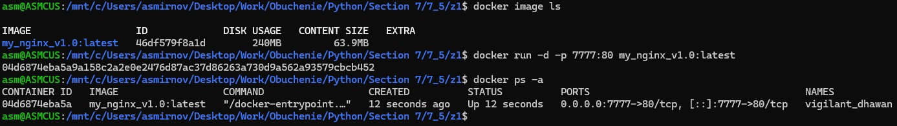
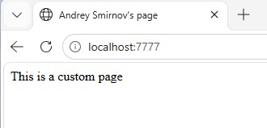
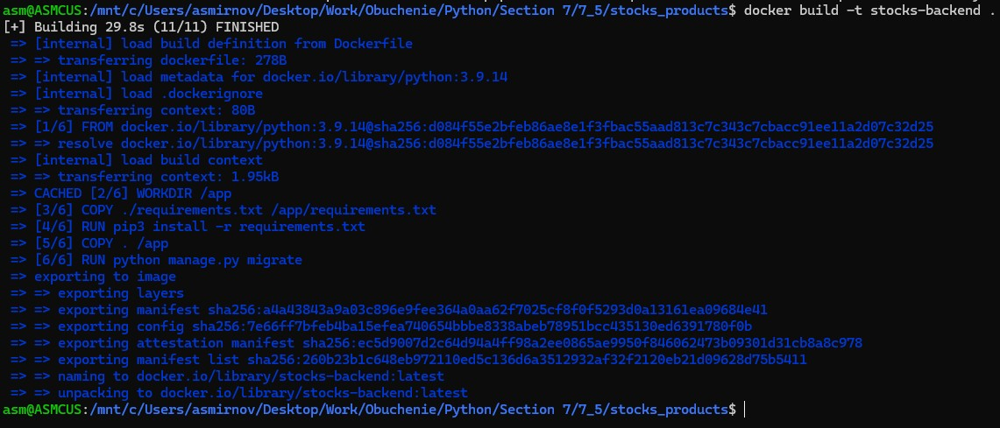
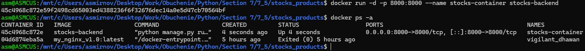
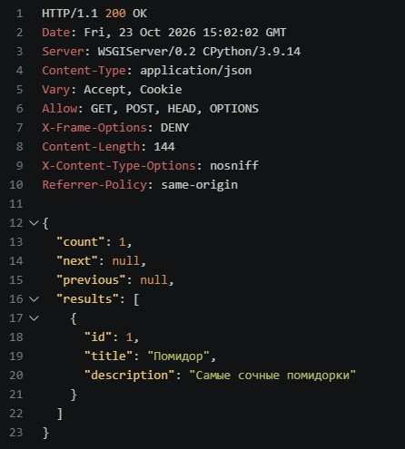
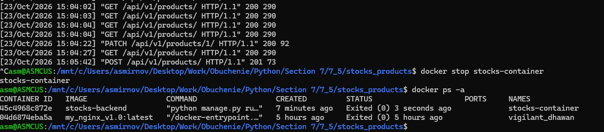

# 7.5. # Домашнее задание к лекции «Docker». - Андрей Смирнов.

Инструкцию по сдаче домашнего задания вы найдете на главной странице репозитория. 

## Задание 1

По аналогии с практикой из лекции создайте свой docker image с http сервером nginx. Замените страницу приветсвия Nginx на своё (измените текст приветствия на той же странице).

<details>
<summary>Подсказки:</summary>
В официальном образе nginx стандартный путь к статичным файлам `/usr/share/nginx/html`.  
</details>

На проверку присылается GitHub-репозиторий с Dockerfile и статичными файлами для него.

> Для пользовательского html можно использовать пример в [каталоге](html/) с ДЗ.


------


### Ответ:


Содержимое `Dockerfile` и сам файл [Dockerfile](./assets/7_5/z1/Dockerfile):

```bash
FROM nginx:latest
COPY html/index.html /usr/share/nginx/html/index.html
EXPOSE 80
```

Кастомная web-страница лежит в [каталоге](./assets/7_5/z1/html/)


Скриншоты демонстрирующие результат:








------


## Задание 2

Создайте контейнер для REST API сервера любого вашего проекта из курса по Django (например, [CRUD: Склады и запасы](https://github.com/netology-code/dj-homeworks/tree/drf/3.2-crud/stocks_products)).

> **ВАЖНО**: поменяйте БД с postgresql на sqlite3. Чтобы ваш контейнер мог работать без зависимости от postgres (с этим мы разберемся на следующем занятии).

Проверьте конфигурацию Django на использование переменных окружения (environment).

- Приложите в репозиторий Dockerfile и файлы приложения.
- В README.md описать типовые команды для запуска контейнера c backend-сервером.

> Для проверки работоспособности вашего контейнера отправляйте запросы с помощью `VS Code REST Client` или `Postman`.


------


### Ответ:


Содержимое `Dockerfile` и сам файл [Dockerfile](./assets/7_5/stocks_products/Dockerfile):


```bash
FROM python:3.9.14

WORKDIR /app

COPY ./requirements.txt /app/requirements.txt
RUN pip3 install -r requirements.txt

COPY . /app
RUN python manage.py migrate

EXPOSE 8000
CMD ["python", "manage.py", "runserver", "0.0.0.0:8000"]
```


Остальные файлы проекта лежат в [каталоге](./assets/7_5/stocks_products/)


Скриншоты демонстрирующие результат:


Сборка образа:




Запуск контейнера и проверка состояния:




Результат выполнения одного из запросов:




Просмотр логов контейнера, его остановка и проверка состояния:




------
