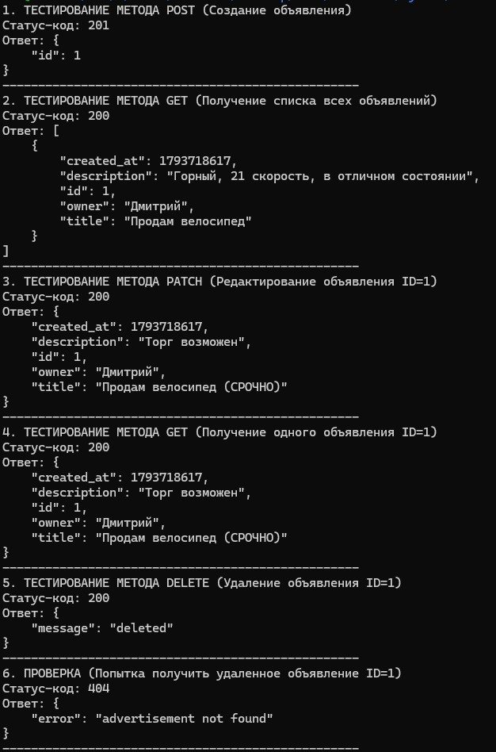

# 7.7. # Flask. - Андрей Смирнов.

Инструкцию по сдаче домашнего задания вы найдете на главной странице репозитория. 

## Задание 1

Вам нужно написать REST API (backend) для сайта объявлений.

Должны быть реализованы методы создания/удаления/редактирования объявления.    

У объявления должны быть следующие поля: 
- заголовок
- описание
- дата создания
- владелец

Результатом работы является API, написанное на Flask.

Этапы выполнения задания:

1. Сделайте роут на Flask.
2. POST метод должен создавать объявление, GET - получать объявление, DELETE - удалять объявление.

------

### Ответ:

Файлы проекта лежат в [каталоге](./assets/7_7/advertisements/) , при реализации за основу был взят подход к проекту показанный на лекции.

Порядок сборки, запуска и тестирования проекта описан в [README.md](./assets/7_7/advertisements/README.md)

Результат тестирования проекта:

