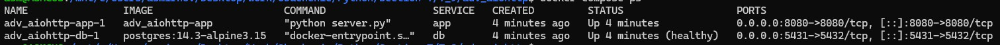
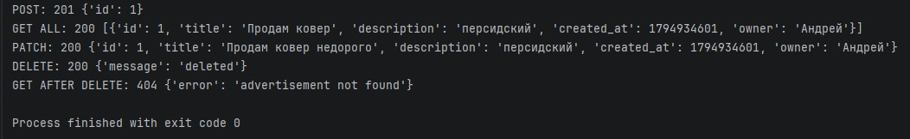

# 7.9. # Aiohttp. - Андрей Смирнов.

Инструкцию по сдаче домашнего задания вы найдете на главной странице репозитория.

## Задание 1

Переписать сервис из [домашнего задания по Flask](../2.1-flask) на aiohttp.

Результатом работы является API, написанный на aiohttp.

## Задание 2 (необязательное)

Докеризировать API, написанный в задании 1.  
Чтобы проверить корректность работы сервиса, нужно:
1. запустить контейнер
2. проверить работу роута

------

### Ответ:

Файлы проекта лежат в [каталоге](./assets/7_9/adv_aiohttp/).

Порядок сборки и запуска проекта описан в [README.md](./assets/7_9/adv_aiohttp/README.md)

Результат сборки, запуска и тестирования проекта:

------